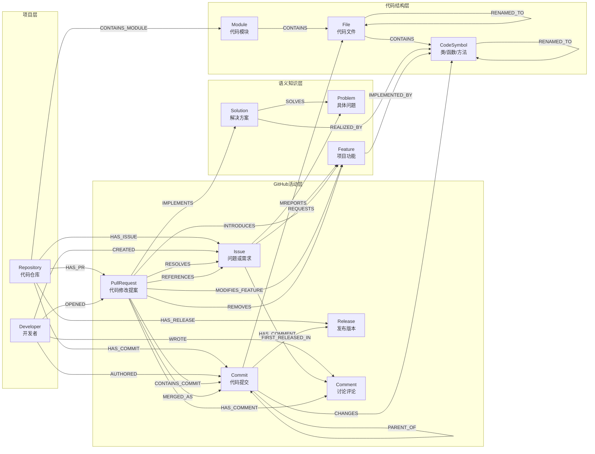
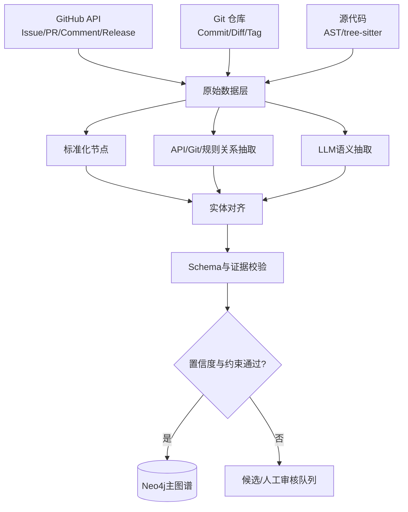
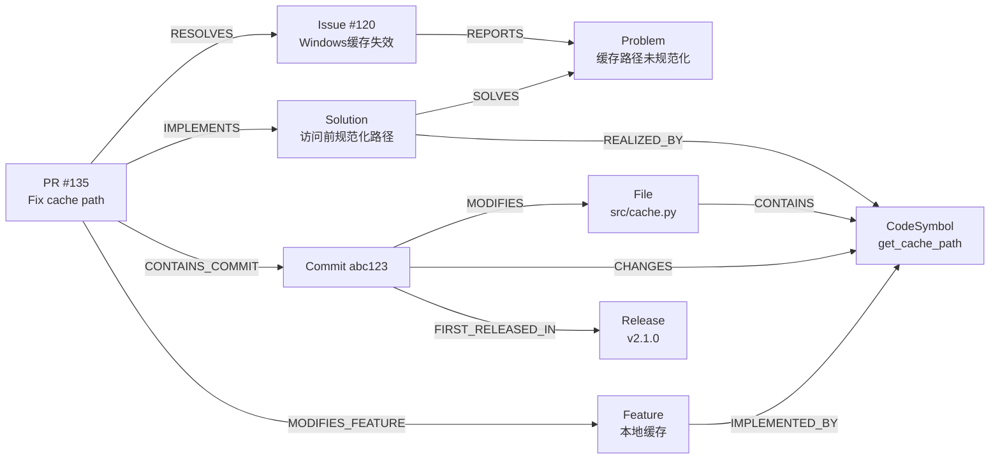

# GitHub 项目考古学家：知识图谱设计文档

> 版本：Schema v1.0  
> 适用阶段：课程项目期中原型与期末扩展  
> 核心目标：将 GitHub 项目中的 Issue、Pull Request、Commit、Release、代码结构和功能语义组织成可查询、可更新、可追溯的知识图谱。

---

## 1. 文档目的

本文档定义“GitHub 项目考古学家”系统的知识图谱 Schema，包括：

- 系统要解决的问题；
- 图谱中的节点类型、关系类型和属性；
- 节点唯一标识和实体对齐规则；
- 时间、证据、置信度和知识状态的表示方法；
- 从 GitHub API、Git 历史、代码和自然语言文本自动建图的流程；
- Neo4j 中的存储方案；
- 图谱支持的查询任务；
- 期中阶段的实现范围和验收标准。

本文档中的“Schema”指知识图谱允许出现的实体类型、关系类型、属性和约束；真实仓库中的 Issue #120、PR #135 等属于 Schema 的实例数据。

---

## 2. 项目定位

### 2.1 目标用户

- 第一次接触某个开源项目的开发者；
- 需要了解项目历史的维护者；
- 希望定位功能演化、Bug 修复过程和版本变化的研究人员。

### 2.2 核心问题

系统重点回答以下三类问题：

1. **Issue 修复追踪**
   - 某个 Issue 由哪个 PR 解决？
   - 包含哪些 Commit？
   - 修改了哪些文件和函数？
   - 最早在哪个 Release 发布？

2. **模块或功能演化追踪**
   - 某个 Module 或 Feature 经历过哪些重要变化？
   - 哪些 Issue 和 PR 推动了这些变化？
   - 哪些代码实体实现了该功能？

3. **版本变化解释**
   - 两个 Release 之间包含哪些重要变化？
   - 增加、修改或删除了哪些 Feature？
   - 每项变化解决了什么 Problem，涉及哪些代码？

### 2.3 知识图谱的实际作用

知识图谱不是 GitHub 数据的可视化装饰，而是系统的结构化长期记忆和查询基础：

- 将 GitHub API、Git、源代码解析和 LLM 抽取结果统一组织；
- 显式维护 Issue、PR、Commit、代码和 Release 之间的跨来源关系；
- 支持多跳路径查询；
- 保存每条知识的来源、证据、时间和置信度；
- 支持新 Issue、PR、Commit 和 Release 的增量更新；
- 为 Agent 提供受约束的相关子图，避免每次重新阅读整个仓库。

---

## 3. 设计原则

### 3.1 任务驱动

只建立能够服务目标查询的实体和关系，不追求无边界地复制整个 GitHub。

### 3.2 确定性事实优先

能通过 GitHub API、Git、AST 或规则确定的事实，不交给 LLM 猜测。

### 3.3 语义知识受约束

LLM 只负责抽取 Problem、Solution、Feature 变化等语义知识，并必须输出符合 JSON Schema 的结构化结果。

### 3.4 所有知识可追溯

关键关系必须保存来源 URL、证据文本、抽取方法和置信度。

### 3.5 时间优先

GitHub 项目不断变化，节点和关系必须保留创建、合并、提交、发布、观察或有效时间。

### 3.6 渐进式扩展

Schema v1 暂不建模 Decision 和 Reason。待核心链路稳定后，再扩展技术决策与设计理由。

---

## 4. 图谱总体结构

图谱分为四层：

1. 项目层：Repository、Developer；
2. GitHub 活动层：Issue、PullRequest、Commit、Release、Comment；
3. 代码结构层：Module、File、CodeSymbol；
4. 语义知识层：Problem、Solution、Feature。



---

## 5. 节点类型设计

## 5.1 Repository

表示被分析的 GitHub 代码仓库，是图谱的根对象。

| 属性 | 类型 | 必需 | 说明 |
|---|---|---:|---|
| `id` | string | 是 | 全局唯一标识，如 `repo:psf/requests` |
| `owner` | string | 是 | 仓库所有者 |
| `name` | string | 是 | 仓库名称 |
| `full_name` | string | 是 | `owner/name` |
| `url` | string | 是 | GitHub 地址 |
| `default_branch` | string | 是 | 默认分支 |
| `primary_language` | string | 否 | 主要编程语言 |
| `description` | string | 否 | 项目描述 |
| `collected_at` | datetime | 是 | 最近采集时间 |

数据来源：GitHub API。

---

## 5.2 Developer

表示 Issue 作者、PR 作者、Commit 作者或评论者。

| 属性 | 类型 | 必需 | 说明 |
|---|---|---:|---|
| `id` | string | 是 | 如 `developer:github:alice` |
| `login` | string | 是 | GitHub 登录名 |
| `name` | string | 否 | 展示名称 |
| `email_hash` | string | 否 | Git 作者只有邮箱时可保存哈希，不保存明文 |
| `url` | string | 否 | GitHub 主页 |
| `account_type` | enum | 否 | `User`、`Bot`、`Organization` |

数据来源：GitHub API、Git author/committer 信息。

对齐规则：

1. 优先使用 GitHub user id 或 login；
2. Git Commit 作者与 GitHub 账号可通过 noreply 邮箱或 API 结果对齐；
3. 无法确认时保留为独立 Developer，不进行强制合并。

---

## 5.3 Issue

表示 GitHub 中的问题、Bug、功能请求或工作任务。

| 属性 | 类型 | 必需 | 说明 |
|---|---|---:|---|
| `id` | string | 是 | 如 `issue:psf/requests:120` |
| `number` | integer | 是 | Issue 编号 |
| `title` | string | 是 | 标题 |
| `body` | text | 否 | 正文，可在图中保存摘要，全文放文本库 |
| `state` | enum | 是 | `open`、`closed` |
| `state_reason` | string | 否 | completed、not_planned 等 |
| `labels` | list | 否 | GitHub 标签 |
| `created_at` | datetime | 是 | 创建时间 |
| `updated_at` | datetime | 是 | 更新时间 |
| `closed_at` | datetime | 否 | 关闭时间 |
| `url` | string | 是 | 原始链接 |

注意：Issue 是信息载体，不等同于 Problem。一个 Issue 可以报告多个 Problem，多个 Issue 也可能描述同一个 Problem。

---

## 5.4 PullRequest

表示开发者提出的一组代码修改和合并请求。

| 属性 | 类型 | 必需 | 说明 |
|---|---|---:|---|
| `id` | string | 是 | 如 `pr:psf/requests:135` |
| `number` | integer | 是 | PR 编号 |
| `title` | string | 是 | 标题 |
| `body` | text | 否 | PR 描述 |
| `state` | enum | 是 | `open`、`closed` |
| `merged` | boolean | 是 | 是否已合并 |
| `draft` | boolean | 否 | 是否为草稿 |
| `base_branch` | string | 是 | 目标分支 |
| `head_branch` | string | 否 | 来源分支 |
| `created_at` | datetime | 是 | 创建时间 |
| `updated_at` | datetime | 是 | 更新时间 |
| `merged_at` | datetime | 否 | 合并时间 |
| `closed_at` | datetime | 否 | 关闭时间 |
| `url` | string | 是 | 原始链接 |

---

## 5.5 Commit

表示 Git 历史中的一次代码提交。

| 属性 | 类型 | 必需 | 说明 |
|---|---|---:|---|
| `id` | string | 是 | 如 `commit:psf/requests:abc123...` |
| `sha` | string | 是 | 完整 Commit SHA |
| `short_sha` | string | 是 | 用于展示的短 SHA |
| `message` | text | 是 | Commit message |
| `authored_at` | datetime | 是 | 作者时间 |
| `committed_at` | datetime | 是 | 提交时间 |
| `additions` | integer | 否 | 新增行数 |
| `deletions` | integer | 否 | 删除行数 |
| `changed_files` | integer | 否 | 修改文件数 |
| `is_merge_commit` | boolean | 否 | 是否为合并提交 |
| `url` | string | 否 | GitHub 链接 |

---

## 5.6 Release

表示项目正式发布的版本。

| 属性 | 类型 | 必需 | 说明 |
|---|---|---:|---|
| `id` | string | 是 | 如 `release:psf/requests:v2.1.0` |
| `tag_name` | string | 是 | Git tag |
| `name` | string | 否 | Release 名称 |
| `body` | text | 否 | Release note |
| `draft` | boolean | 是 | 是否草稿 |
| `prerelease` | boolean | 是 | 是否预发布版本 |
| `created_at` | datetime | 否 | 创建时间 |
| `published_at` | datetime | 否 | 发布时间 |
| `url` | string | 是 | 原始链接 |

Release 与 Git tag 相关，但第一版将其作为同一类业务对象处理。若仓库存在无 GitHub Release 的 tag，可创建仅包含 `tag_name` 的 Release 实例，并标记 `source=git_tag`。

---

## 5.7 Comment

表示 Issue、PR 或未来 Discussion 中的评论。

| 属性 | 类型 | 必需 | 说明 |
|---|---|---:|---|
| `id` | string | 是 | GitHub comment id |
| `body` | text | 是 | 评论正文 |
| `created_at` | datetime | 是 | 创建时间 |
| `updated_at` | datetime | 否 | 更新时间 |
| `url` | string | 是 | 原始链接 |
| `comment_type` | enum | 是 | `issue_comment`、`review_comment` 等 |

Comment 在 Schema v1 中主要作为语义抽取的数据来源，不直接建模 Decision 和 Reason。

---

## 5.8 Module

表示项目中的逻辑代码模块，可以对应目录，也可以跨多个目录和文件。

| 属性 | 类型 | 必需 | 说明 |
|---|---|---:|---|
| `id` | string | 是 | 如 `module:psf/requests:authentication` |
| `name` | string | 是 | 模块规范名称 |
| `description` | string | 否 | 模块职责 |
| `aliases` | list | 否 | 模块别名 |
| `path_prefixes` | list | 是 | 对应路径或路径前缀 |
| `definition_method` | enum | 是 | `manual`、`rule`、`llm` |

Schema v1 建议人工定义 5～15 个主要 Module，避免自动架构识别带来的不稳定性。

示例：

```yaml
modules:
  - id: module:cache
    name: cache
    aliases: [caching, local-cache]
    path_prefixes:
      - src/cache/
      - src/cache.py
```

---

## 5.9 File

表示仓库中的源代码文件或其他重要文件。

| 属性 | 类型 | 必需 | 说明 |
|---|---|---:|---|
| `id` | string | 是 | 如 `file:psf/requests:src/cache.py` |
| `path` | string | 是 | 仓库相对路径 |
| `name` | string | 是 | 文件名 |
| `extension` | string | 否 | 扩展名 |
| `language` | string | 否 | 编程语言 |
| `is_test` | boolean | 否 | 是否为测试文件 |
| `first_seen_at` | datetime | 否 | 首次出现时间 |
| `last_seen_at` | datetime | 否 | 最近出现时间 |
| `status` | enum | 否 | `active`、`deleted` |

Schema v1 使用仓库标识加路径作为 File 身份。文件重命名时创建新 File，并使用 `RENAMED_TO` 连接旧路径和新路径。

---

## 5.10 CodeSymbol

统一表示类、函数和方法。

| 属性 | 类型 | 必需 | 说明 |
|---|---|---:|---|
| `id` | string | 是 | 如 `symbol:repo:path:qualified_name` |
| `name` | string | 是 | 简称 |
| `qualified_name` | string | 是 | 限定名 |
| `kind` | enum | 是 | `class`、`function`、`method` |
| `signature` | string | 否 | 函数或方法签名 |
| `docstring` | text | 否 | 文档字符串 |
| `start_line` | integer | 否 | 起始行 |
| `end_line` | integer | 否 | 结束行 |
| `status` | enum | 否 | `active`、`deleted` |

Schema v1 不建模变量、表达式和代码语句，避免图谱规模过大。

---

## 5.11 Problem

表示 Issue 或讨论中描述的、可复用的具体问题语义。

| 属性 | 类型 | 必需 | 说明 |
|---|---|---:|---|
| `id` | string | 是 | 规范化问题标识 |
| `name` | string | 是 | 简短问题名称 |
| `description` | text | 否 | 问题说明 |
| `problem_type` | enum | 是 | `bug`、`performance`、`security`、`compatibility` 等 |
| `status` | enum | 否 | `open`、`resolved`、`unknown` |
| `confidence` | float | 是 | 抽取置信度 |
| `canonical_key` | string | 否 | 用于问题对齐的规范化键 |

Problem 由 LLM 从 Issue、PR 或 Comment 文本中抽取，并通过相似度、模块和相关代码等信息进行对齐。

---

## 5.12 Solution

表示某个 PR 或代码变化采用的解决方案。

| 属性 | 类型 | 必需 | 说明 |
|---|---|---:|---|
| `id` | string | 是 | 解决方案标识 |
| `name` | string | 是 | 简短名称 |
| `description` | text | 否 | 方案说明 |
| `solution_type` | enum | 否 | `fix`、`refactor`、`workaround`、`optimization` 等 |
| `confidence` | float | 是 | 抽取置信度 |

Solution 描述“这次具体怎么解决”，不表示多个候选方案之间的决策过程。

---

## 5.13 Feature

表示项目长期向用户或开发者提供的功能能力。

| 属性 | 类型 | 必需 | 说明 |
|---|---|---:|---|
| `id` | string | 是 | 如 `feature:http-retry` |
| `name` | string | 是 | 规范名称 |
| `description` | text | 否 | 功能描述 |
| `aliases` | list | 否 | 同义表达或缩写 |
| `status` | enum | 是 | `planned`、`active`、`deprecated`、`removed` |
| `definition_method` | enum | 是 | `manual`、`llm_proposed`、`manual_confirmed` |

Feature 与 CodeSymbol 之间是多对多关系：一个 Feature 可由多个函数或类实现，一个 CodeSymbol 也可能参与多个 Feature。

Schema v1 建议从 README、文档和主要模块中人工定义 10～20 个 Feature，并限制 LLM 只能从已有 Feature 中选择。新的 Feature 候选必须经过人工确认后进入主图谱。

示例：

```yaml
features:
  - id: feature:http-retry
    name: HTTP 自动重试
    aliases: [retry, retries, retry mechanism]
    status: active
    seed_symbols:
      - Retry
      - HTTPAdapter.send
```

---

## 6. 关系类型设计

## 6.1 项目归属关系

| 关系 | 起点 | 终点 | 含义 | 来源 |
|---|---|---|---|---|
| `HAS_ISSUE` | Repository | Issue | 仓库拥有 Issue | API |
| `HAS_PR` | Repository | PullRequest | 仓库拥有 PR | API |
| `HAS_COMMIT` | Repository | Commit | 仓库拥有 Commit | Git/API |
| `HAS_RELEASE` | Repository | Release | 仓库拥有 Release | API/Git tag |
| `CONTAINS_MODULE` | Repository | Module | 仓库包含逻辑模块 | 人工配置 |

## 6.2 开发者关系

| 关系 | 起点 | 终点 | 含义 | 来源 |
|---|---|---|---|---|
| `CREATED` | Developer | Issue | 创建 Issue | API |
| `OPENED` | Developer | PullRequest | 创建 PR | API |
| `AUTHORED` | Developer | Commit | 编写 Commit | Git/API |
| `WROTE` | Developer | Comment | 编写评论 | API |

## 6.3 Issue、PR 和讨论关系

| 关系 | 起点 | 终点 | 含义 | 来源 |
|---|---|---|---|---|
| `HAS_COMMENT` | Issue/PR | Comment | Issue 或 PR 包含评论 | API |
| `RESOLVES` | PullRequest | Issue | PR 明确解决 Issue | API 关闭事件、规则 |
| `REFERENCES` | PullRequest | Issue | PR 提到但不一定解决 Issue | 编号引用规则 |

`RESOLVES` 与 `REFERENCES` 必须严格区分：

- `Fixes #120`、`Closes #120`、`Resolves #120` 可生成 `RESOLVES`；
- `Related to #120`、`See #120`、普通 `#120` 引用生成 `REFERENCES`；
- 只有引用但无关闭语义时，不得生成 `RESOLVES`。

## 6.4 PR、Commit 和版本关系

| 关系 | 起点 | 终点 | 含义 | 来源 |
|---|---|---|---|---|
| `CONTAINS_COMMIT` | PullRequest | Commit | PR 中包含原始 Commit | API |
| `MERGED_AS` | PullRequest | Commit | PR 合并后在目标分支中的 merge/squash Commit | API/Git |
| `PARENT_OF` | Commit | Commit | Git 父子历史关系 | Git |
| `FIRST_RELEASED_IN` | Commit | Release | Commit 首次进入的正式版本 | Git tag 推导 |

`CONTAINS_COMMIT` 和 `MERGED_AS` 不等价。Squash merge 时，PR 中的原始 Commit 与主分支上的合并 Commit 可能不同。

`FIRST_RELEASED_IN` 定义为：包含该 Commit 的最早正式 Release。系统不为每个 Commit 建立指向所有后续 Release 的冗余边。

## 6.5 代码结构与变化关系

| 关系 | 起点 | 终点 | 含义 | 来源 |
|---|---|---|---|---|
| `CONTAINS` | Module | File | 模块包含文件 | 人工配置/路径规则 |
| `CONTAINS` | File | CodeSymbol | 文件定义类、函数或方法 | AST/tree-sitter |
| `MODIFIES` | Commit | File | Commit 修改文件 | Git diff |
| `CHANGES` | Commit | CodeSymbol | Commit 修改代码实体 | diff 行号 + AST |
| `RENAMED_TO` | File | File | 文件被重命名 | Git rename detection |
| `RENAMED_TO` | CodeSymbol | CodeSymbol | 代码实体被重命名或迁移 | 规则/相似度/人工确认 |

`MODIFIES` 边建议保存：

```json
{
  "change_type": "modified",
  "additions": 15,
  "deletions": 4,
  "old_path": "src/cache.py",
  "new_path": "src/cache.py"
}
```

`change_type` 可取：`added`、`modified`、`deleted`、`renamed`。

## 6.6 问题与解决方案关系

| 关系 | 起点 | 终点 | 含义 | 来源 |
|---|---|---|---|---|
| `REPORTS` | Issue | Problem | Issue 报告问题 | LLM + 证据 |
| `IMPLEMENTS` | PullRequest | Solution | PR 实现解决方案 | LLM + 证据 |
| `SOLVES` | Solution | Problem | 解决方案解决问题 | LLM/图规则 + 验证 |
| `REALIZED_BY` | Solution | CodeSymbol | 方案由代码实体实现 | PR-Commit-Symbol 路径 + LLM 验证 |

## 6.7 功能演化关系

| 关系 | 起点 | 终点 | 含义 | 来源 |
|---|---|---|---|---|
| `REQUESTS` | Issue | Feature | Issue 请求增加或改变功能 | LLM 分类 |
| `INTRODUCES` | PullRequest | Feature | PR 引入新功能 | LLM 分类 + 人工/规则校验 |
| `MODIFIES_FEATURE` | PullRequest | Feature | PR 修改现有功能 | LLM 分类 + 人工/规则校验 |
| `REMOVES` | PullRequest | Feature | PR 删除功能 | LLM 分类 + 人工/规则校验 |
| `IMPLEMENTED_BY` | Feature | CodeSymbol | 功能由代码实体实现 | 人工种子、路径推断、LLM 验证 |

Feature 与 CodeSymbol 的联系不能仅通过“某个 PR 修改了某函数”直接判定。推荐流程：

1. 人工定义核心 Feature 和种子 CodeSymbol；
2. 通过 PR → Commit → CodeSymbol 路径生成候选；
3. 使用 Feature 描述、PR 文本、函数名、docstring 和代码片段验证；
4. 低置信度候选不进入主图谱，进入人工审核队列。

---

## 7. 统一标识规则

所有节点必须拥有稳定、全局唯一的 `id`。

| 节点 | ID 模板 |
|---|---|
| Repository | `repo:{owner}/{repo}` |
| Developer | `developer:github:{login}` |
| Issue | `issue:{owner}/{repo}:{number}` |
| PullRequest | `pr:{owner}/{repo}:{number}` |
| Commit | `commit:{owner}/{repo}:{full_sha}` |
| Release | `release:{owner}/{repo}:{tag}` |
| Comment | `comment:{owner}/{repo}:{comment_id}` |
| Module | `module:{owner}/{repo}:{canonical_name}` |
| File | `file:{owner}/{repo}:{path}` |
| CodeSymbol | `symbol:{owner}/{repo}:{path}:{qualified_name}` |
| Problem | `problem:{owner}/{repo}:{canonical_key}` |
| Solution | `solution:{owner}/{repo}:{source_pr}:{index}` |
| Feature | `feature:{owner}/{repo}:{canonical_name}` |

禁止只使用 Issue 编号、PR 编号或文件名作为全局 ID，因为不同仓库可能存在相同编号或名称。

---

## 8. 证据、来源与置信度

每条非平凡关系至少保存以下属性：

| 属性 | 类型 | 说明 |
|---|---|---|
| `evidence` | text | 支持该关系的证据文本或结构化说明 |
| `evidence_url` | string | 原始 GitHub URL 或 Commit URL |
| `method` | enum | 知识获取方法 |
| `confidence` | float | `[0,1]` 置信度 |
| `observed_at` | datetime | 系统获得该知识的时间 |
| `valid_from` | datetime | 关系开始有效的时间，可选 |
| `valid_to` | datetime | 关系结束有效的时间，可选 |
| `status` | enum | `asserted`、`inferred`、`candidate`、`rejected` |

`method` 取值：

| 方法 | 含义 |
|---|---|
| `api` | GitHub API 直接提供 |
| `git` | Git 历史直接提供 |
| `ast` | 代码解析得到 |
| `rule` | 正则或规则抽取 |
| `llm` | LLM 语义抽取 |
| `manual` | 人工确认 |
| `inferred` | 根据图路径或规则推断 |

置信度原则：

- API、Git 直接事实通常为 `1.0`；
- 明确关闭规则 `Fixes #N` 为 `1.0`；
- 普通编号引用只生成 `REFERENCES`，置信度可为 `0.8～1.0`；
- LLM 抽取结果必须经过 Schema、实体和证据校验；
- 推断关系必须标记为 `inferred`，不得伪装成直接事实。

关系实例示例：

```json
{
  "source_id": "pr:owner/repo:135",
  "source_type": "PullRequest",
  "relation": "RESOLVES",
  "target_id": "issue:owner/repo:120",
  "target_type": "Issue",
  "evidence": "Fixes #120",
  "evidence_url": "https://github.com/owner/repo/pull/135",
  "method": "rule",
  "confidence": 1.0,
  "observed_at": "2026-10-30T10:00:00+08:00",
  "status": "asserted"
}
```

---

## 9. 时间表示

Schema v1 不建立独立 Time 节点，时间直接作为节点或边属性。

主要时间属性：

- Issue：`created_at`、`updated_at`、`closed_at`；
- PR：`created_at`、`updated_at`、`merged_at`；
- Commit：`authored_at`、`committed_at`；
- Release：`published_at`；
- 知识关系：`observed_at`、`valid_from`、`valid_to`。

需要区分：

1. **事件时间**：Issue 创建、PR 合并、Commit 提交、Release 发布的时间；
2. **观察时间**：系统什么时候采集到该事实；
3. **有效时间**：某个 Feature 或代码关系在哪段时间内有效。

---

## 10. Schema 约束

## 10.1 Domain/Range 约束

| 关系 | Domain | Range |
|---|---|---|
| `RESOLVES` | PullRequest | Issue |
| `REFERENCES` | PullRequest | Issue |
| `CONTAINS_COMMIT` | PullRequest | Commit |
| `MERGED_AS` | PullRequest | Commit |
| `MODIFIES` | Commit | File |
| `CHANGES` | Commit | CodeSymbol |
| `FIRST_RELEASED_IN` | Commit | Release |
| `REPORTS` | Issue | Problem |
| `IMPLEMENTS` | PullRequest | Solution |
| `SOLVES` | Solution | Problem |
| `REALIZED_BY` | Solution | CodeSymbol |
| `REQUESTS` | Issue | Feature |
| `INTRODUCES` | PullRequest | Feature |
| `MODIFIES_FEATURE` | PullRequest | Feature |
| `REMOVES` | PullRequest | Feature |
| `IMPLEMENTED_BY` | Feature | CodeSymbol |

不符合 Domain/Range 的 LLM 结果必须拒绝写入主图谱。

## 10.2 基本一致性约束

- 同一仓库中 Issue number 唯一；
- 同一仓库中 PR number 唯一；
- Commit full SHA 唯一；
- 同一仓库中 Release tag 唯一；
- 已标记 `REMOVES` 的 Feature 应更新为 `removed` 或在后续 PR 中重新引入；
- `FIRST_RELEASED_IN` 对同一 Commit 原则上最多一个；
- `MERGED_AS` 对普通 PR 原则上最多一个；
- `RESOLVES` 必须存在明确关闭依据或人工确认；
- `Feature-IMPLEMENTED_BY-CodeSymbol` 必须有人工种子、代码路径或语义证据之一。

## 10.3 开放世界说明

图谱中没有某条关系，不表示关系一定不存在。例如没有找到 PR → Issue 的 `RESOLVES`，只能表示当前数据中未确认该关系，不能断言 Issue 从未被解决。

---

## 11. 自动建图流程



### 11.1 数据采集

GitHub API 获取：

- Repository 元数据；
- Issue、PR、Comment；
- PR 包含的 Commit；
- Release；
- 开发者信息。

Git 获取：

- Commit 和父子历史；
- diff 与修改文件；
- 文件新增、删除、重命名；
- tag 与 Commit 可达关系。

代码解析获取：

- File 中的 Class、Function、Method；
- CodeSymbol 的行号范围、签名和 docstring；
- diff 修改行所对应的 CodeSymbol。

### 11.2 确定性关系抽取

不调用 LLM，直接生成：

- Repository → Issue/PR/Commit/Release；
- Developer → Issue/PR/Commit/Comment；
- PR → Commit；
- Commit → File；
- File → CodeSymbol；
- Commit → CodeSymbol；
- Commit → Release；
- `Fixes/Closes/Resolves #N` 形成 PR → Issue 的 `RESOLVES`；
- 普通 `#N` 引用形成 `REFERENCES`。

### 11.3 LLM 语义抽取

LLM 输入：

- Issue 标题、正文和高价值评论；
- PR 标题、正文和高价值评论；
- 修改文件、CodeSymbol 和 diff 摘要；
- 预定义 Feature 列表。

LLM 输出：

```json
{
  "problems": [
    {
      "name": "Windows cache path inconsistency",
      "type": "compatibility",
      "evidence": "Cache lookup fails on Windows because paths are not normalized.",
      "confidence": 0.93
    }
  ],
  "solutions": [
    {
      "name": "Normalize cache path before lookup",
      "type": "fix",
      "evidence": "Normalize paths before querying the cache.",
      "confidence": 0.91
    }
  ],
  "feature_changes": [
    {
      "feature_id": "feature:cache",
      "change_type": "modify",
      "evidence": "This changes the cache lookup behavior.",
      "confidence": 0.88
    }
  ]
}
```

要求：

- 只能输出符合 JSON Schema 的结果；
- Problem 和 Solution 必须提供证据句；
- Feature 必须优先从预定义候选中选择；
- 不允许根据常识补充文本中不存在的事实；
- 低置信度结果进入审核队列。

### 11.4 实体对齐

对齐顺序：

1. 精确 ID：Issue number、PR number、Commit SHA；
2. 路径和限定名：File path、qualified symbol name；
3. 别名词典：Module、Feature 别名；
4. 名称相似度和文本向量生成候选；
5. 上下文、相关模块和图邻居验证；
6. 低置信度候选人工确认。

### 11.5 校验与写入

写入 Neo4j 前必须完成：

- JSON Schema 校验；
- Domain/Range 校验；
- 节点 ID 和引用完整性校验；
- 重复节点检测；
- 证据存在性校验；
- 置信度阈值校验；
- 冲突检测。

---

## 12. Neo4j 存储设计

本项目采用属性图模型：

- 节点标签对应实体类型；
- 关系类型对应 Schema 中的关系；
- 节点和边都可以保存属性；
- 证据、时间和置信度保存为边属性。

### 12.1 唯一约束示例

```cypher
CREATE CONSTRAINT repository_id IF NOT EXISTS
FOR (n:Repository) REQUIRE n.id IS UNIQUE;

CREATE CONSTRAINT issue_id IF NOT EXISTS
FOR (n:Issue) REQUIRE n.id IS UNIQUE;

CREATE CONSTRAINT pr_id IF NOT EXISTS
FOR (n:PullRequest) REQUIRE n.id IS UNIQUE;

CREATE CONSTRAINT commit_id IF NOT EXISTS
FOR (n:Commit) REQUIRE n.id IS UNIQUE;

CREATE CONSTRAINT release_id IF NOT EXISTS
FOR (n:Release) REQUIRE n.id IS UNIQUE;

CREATE CONSTRAINT file_id IF NOT EXISTS
FOR (n:File) REQUIRE n.id IS UNIQUE;

CREATE CONSTRAINT symbol_id IF NOT EXISTS
FOR (n:CodeSymbol) REQUIRE n.id IS UNIQUE;

CREATE CONSTRAINT feature_id IF NOT EXISTS
FOR (n:Feature) REQUIRE n.id IS UNIQUE;
```

### 12.2 写入关系示例

```cypher
MATCH (pr:PullRequest {id: $pr_id})
MATCH (issue:Issue {id: $issue_id})
MERGE (pr)-[r:RESOLVES]->(issue)
SET r.evidence = $evidence,
    r.evidence_url = $evidence_url,
    r.method = $method,
    r.confidence = $confidence,
    r.observed_at = datetime($observed_at),
    r.status = $status;
```

---

## 13. 典型查询路径

## 13.1 Issue 修复追踪

目标路径：

```text
Issue
← RESOLVES - PullRequest
→ CONTAINS_COMMIT - Commit
→ MODIFIES - File
→ CHANGES - CodeSymbol
→ FIRST_RELEASED_IN - Release
```

Cypher 示例：

```cypher
MATCH (i:Issue {number: $issue_number})
OPTIONAL MATCH (pr:PullRequest)-[:RESOLVES]->(i)
OPTIONAL MATCH (pr)-[:CONTAINS_COMMIT]->(c:Commit)
OPTIONAL MATCH (c)-[:MODIFIES]->(f:File)
OPTIONAL MATCH (c)-[:CHANGES]->(s:CodeSymbol)
OPTIONAL MATCH (c)-[:FIRST_RELEASED_IN]->(r:Release)
OPTIONAL MATCH (i)-[:REPORTS]->(p:Problem)
OPTIONAL MATCH (pr)-[:IMPLEMENTS]->(sol:Solution)-[:SOLVES]->(p)
RETURN i, pr, c, f, s, r, p, sol;
```

## 13.2 Feature 演化追踪

目标路径：

```text
Feature
← INTRODUCES/MODIFIES_FEATURE/REMOVES - PullRequest
→ CONTAINS_COMMIT - Commit
→ CHANGES - CodeSymbol
→ FIRST_RELEASED_IN - Release
```

```cypher
MATCH (feature:Feature {id: $feature_id})
MATCH (pr:PullRequest)-[change:INTRODUCES|MODIFIES_FEATURE|REMOVES]->(feature)
OPTIONAL MATCH (pr)-[:CONTAINS_COMMIT]->(c:Commit)
OPTIONAL MATCH (c)-[:CHANGES]->(s:CodeSymbol)
OPTIONAL MATCH (c)-[:FIRST_RELEASED_IN]->(r:Release)
RETURN feature, pr, type(change) AS change_type, c, s, r
ORDER BY pr.merged_at;
```

## 13.3 Module 演化追踪

目标路径：

```text
Module
→ File
← MODIFIES - Commit
← CONTAINS_COMMIT - PullRequest
→ Issue/Feature
```

```cypher
MATCH (m:Module {id: $module_id})-[:CONTAINS]->(f:File)
MATCH (c:Commit)-[:MODIFIES]->(f)
OPTIONAL MATCH (pr:PullRequest)-[:CONTAINS_COMMIT]->(c)
OPTIONAL MATCH (pr)-[:RESOLVES]->(i:Issue)
OPTIONAL MATCH (pr)-[fc:INTRODUCES|MODIFIES_FEATURE|REMOVES]->(feature:Feature)
OPTIONAL MATCH (c)-[:FIRST_RELEASED_IN]->(r:Release)
RETURN m, f, c, pr, i, feature, type(fc), r
ORDER BY c.committed_at;
```

## 13.4 版本差异解释

版本范围先由 Git 计算，再利用图谱补充 PR、Issue、Feature 和代码关系。

```cypher
MATCH (c:Commit)
WHERE c.sha IN $commit_shas_between_versions
OPTIONAL MATCH (pr:PullRequest)-[:CONTAINS_COMMIT|MERGED_AS]->(c)
OPTIONAL MATCH (pr)-[:RESOLVES]->(i:Issue)
OPTIONAL MATCH (pr)-[fc:INTRODUCES|MODIFIES_FEATURE|REMOVES]->(feature:Feature)
OPTIONAL MATCH (c)-[:MODIFIES]->(f:File)
RETURN c, pr, i, feature, type(fc), f;
```

---

## 14. 实例示例



该实例可以回答：

- Issue #120 报告了什么问题？
- 哪个 PR 解决了该问题？
- 采取了什么解决方案？
- 修改了哪个文件和函数？
- 影响了哪个 Feature？
- 最早在哪个 Release 发布？

---

## 15. 增量更新

系统为每个仓库记录：

- `last_collected_at`；
- 最近处理的 Issue/PR `updated_at`；
- 最近处理的默认分支 Commit SHA；
- 最近处理的 Release/tag。

更新流程：

1. 拉取自上次更新时间之后变化的 Issue、PR 和 Comment；
2. 从上次 Commit SHA 向前解析新增 Commit；
3. 更新新增或变化的 File、CodeSymbol；
4. 只对新文本或已修改文本运行 LLM；
5. 使用 `MERGE` 写入 Neo4j，避免重复节点和边；
6. 对被关闭、重开、删除或重命名的对象更新状态；
7. 重新计算受影响 Commit 的 `FIRST_RELEASED_IN`。

---

## 16. 图谱质量评估

### 16.1 四个质量维度

| 维度 | 项目中的含义 | 示例指标 |
|---|---|---|
| 准确性 | 实体和关系是否正确 | Relation Precision、实体对齐准确率 |
| 一致性 | 是否违反 Schema 或业务约束 | Domain/Range 违规率、重复节点率 |
| 完整性 | 修复和演化路径是否完整 | 完整 Issue→PR→Commit→Release 路径比例 |
| 时效性 | 是否反映最新项目状态 | 更新延迟、过期节点比例 |

### 16.2 知识抽取实验

建立人工标注集，对比：

- 规则抽取；
- 普通 LLM Prompt；
- Schema 约束 LLM；
- 规则 + LLM 混合方案。

指标：

- Precision；
- Recall；
- F1；
- 证据准确率；
- JSON 合法率；
- Schema 违规率。

### 16.3 下游任务实验

对比：

- LLM；
- 普通 RAG；
- 纯图查询；
- KG + RAG。

指标：

- Answer Accuracy；
- Path Accuracy；
- Evidence Precision；
- Answer Completeness；
- Hallucination Rate；
- Query Latency。

---

## 17. 期中实现范围

### 17.1 必须完成

- 选择 1 个开源仓库；
- 50～100 个 Issue；
- 30～50 个已合并 PR；
- 100～300 个 Commit；
- 3～10 个 Release；
- 5～15 个 Module；
- 10～20 个人工定义 Feature；
- 至少 10 条完整 Issue 修复链；
- 核心节点和关系自动导入 Neo4j；
- Issue 修复、Module/Feature 演化、版本变化三类查询；
- 一个展示答案、图路径、时间线和证据的 Demo；
- 5～10 个普通 RAG 与 KG+RAG 的对比问题。

### 17.2 期中暂不实现

- Decision 和 Reason 节点；
- 完全开放的自然语言转 Cypher；
- 自动识别所有 Module；
- 变量、语句级代码图；
- 多仓库联合分析；
- 所有编程语言的统一解析；
- 复杂分支和未合并分支的全面建模；
- 大规模分布式图数据库。

### 17.3 期中验收核心

给定一个真实 Issue 编号，系统能够自动输出：

```text
Issue
→ Problem
← Solution
← PullRequest
→ Commit
→ File/CodeSymbol
→ Feature
→ Release
```

并且每项关键结论都能展示原始 GitHub 证据。

---

## 18. 推荐代码模块

```text
github-archaeologist/
├── data/
│   ├── raw/
│   ├── processed/
│   ├── gold/
│   └── review_queue/
├── ontology/
│   ├── schema.yaml
│   ├── constraints.yaml
│   ├── modules.yaml
│   └── features.yaml
├── collector/
│   ├── github_api.py
│   └── git_repository.py
├── parser/
│   ├── git_parser.py
│   ├── diff_parser.py
│   └── code_parser.py
├── extractor/
│   ├── rule_extractor.py
│   ├── llm_extractor.py
│   └── entity_resolver.py
├── validator/
│   ├── schema_validator.py
│   ├── evidence_validator.py
│   └── conflict_detector.py
├── graph/
│   ├── importer.py
│   ├── incremental_updater.py
│   └── queries.py
├── qa/
│   ├── intent_classifier.py
│   ├── graph_retriever.py
│   ├── rag_retriever.py
│   └── answer_generator.py
├── evaluation/
│   ├── evaluate_extraction.py
│   └── evaluate_qa.py
└── demo/
    └── app.py
```

---

## 19. Schema 变更规则

新增节点或关系前必须回答：

1. 它能支持哪个明确的用户问题？
2. 数据能否稳定获取？
3. 它是否能通过现有节点或关系推导？
4. 是否有可靠的唯一标识？
5. 是否能够保存来源和证据？
6. 增加后会不会显著提高构建和维护成本？

如果新元素不能服务核心任务，或只能由 LLM 无证据猜测，则不应进入主 Schema。

---

## 20. 总结

Schema v1 由 13 类节点组成：

```text
Repository、Developer、Issue、PullRequest、Commit、Release、Comment、
Module、File、CodeSymbol、Problem、Solution、Feature
```

其核心知识链为：

```text
Issue → Problem ← Solution ← PullRequest
PullRequest → Commit → File/CodeSymbol → Release
PullRequest → Feature → CodeSymbol
```

其中：

- GitHub API、Git 和代码解析负责构建可靠的客观骨架；
- 规则负责抽取显式编号和关闭关系；
- LLM 负责抽取 Problem、Solution 和 Feature 变化；
- Schema、证据和置信度机制负责控制质量；
- Neo4j 负责存储和执行多跳查询；
- RAG 负责补充原始文本；
- LLM 最后根据图谱路径和证据生成自然语言答案。

该设计能够支撑期中的最小 Demo，并为期末增加技术决策、动态更新和更复杂实验保留扩展空间。
