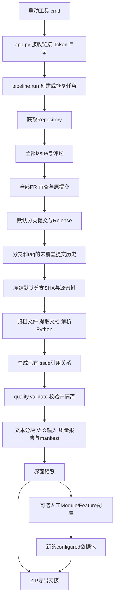

# 项目文件说明与数据处理流程

适用目录：`C:\Users\myshine\Desktop\github\archaeologist-ui`。

2026-11-02新增本地Git补采：`git_collect.py`负责共享裸仓库缓存、提交历史与差异解析；界面已提供独立补采和API完成后自动补采。输出规则详见[本地Git采集使用说明](本地Git采集使用说明.md)。下文原有章节主要说明API处理流程。

本文根据当前提速后的全量采集代码整理。此目录是一套Python桌面数据处理程序，不是目标仓库mlxtend的源码，也不是已经构建好的知识图谱数据库。

## 1. 整个目录分为四类

```text
archaeologist-ui/
├── 启动工具.cmd                 # Windows启动入口
├── app.py                       # 窗口与用户操作
├── pipeline.py                  # 采集、清洗、结构化与输出主流程
├── quality.py                   # 字段/关系校验与文本分块
├── configuration.py             # 人工Module/Feature配置应用
├── test_pipeline.py             # 基础流程测试
├── test_quality.py              # 分页、分块与校验测试
├── test_full.py                 # 全量模式测试
├── test_configuration.py        # 配置处理测试
├── test_efficiency.py           # 减少重复请求与证据定位测试
├── README.md                    # 使用概览和版本变化
├── 全量采集说明.md               # 全量范围、限制与恢复方式
├── 提速与进度条说明.md           # 提速方式与进度含义
├── 项目文件说明与数据处理流程.md # 本文
├── .gitignore                   # Git提交时的忽略规则
├── __pycache__/                 # Python自动生成的字节码缓存
└── data/                        # 用户实际采集的结果
```

日常使用只需启动程序、操作窗口和查看data。测试文件不需要每次手动运行；__pycache__也不需要编辑。

## 2. 每个程序文件负责什么

### 2.1 启动工具.cmd：找到Python并打开窗口

先切换到本文件所在目录；优先调用当前电脑Codex附带的Python，找不到时尝试`py app.py`；启动出错时暂停以便查看提示。

它不是爬虫，也不处理数据。它是Windows的便捷启动入口，跨电脑使用时仍需确保有带Tkinter的Python环境。

### 2.2 app.py：界面和操作调度

| 界面功能 | 主要方法 | 职责 |
|---|---|---|
| 窗口布局 | App.__init__ | 创建输入栏、进度、预览、质量、配置、历史页面 |
| 开始任务 | start | 校验仓库链接，读取Token和目录，用后台线程调用pipeline.run |
| 更新界面 | poll | 从消息队列读取阶段、进度、耗时、请求和错误消息 |
| 查看结果 | load / preview / detail | 读取已有文件并显示；可搜索，最多显示1000条匹配结果 |
| 查看原始证据 | show_evidence | 从evidence_ids找到raw_ref，读取原始响应或配置 |
| 恢复任务 | restore | 读取job.json，复用原目录缓存重新处理 |
| 模块功能表单 | add_config等 | 编辑配置，导入/保存JSON；不会自动推断功能 |
| 应用配置 | apply_config | 后台调用configuration.enrich生成新的交接结果 |
| 历史任务 | refresh_history / load_history | 扫描保存目录，显示最多100个最近任务 |
| 导出 | export / background | 后台压缩结果，不阻塞窗口 |

主线程操作Tkinter；后台线程负责网络和长任务，通过queue传消息。取消使用threading.Event，网络请求完成或超时后才有机会响应。程序没有多线程批量并发请求GitHub。

Token在内存中使用，不写入job、manifest或结果包。界面预览数据不等于已经将数据导入Neo4j。

### 2.3 pipeline.py：核心数据流水线

| 代码组件 | 做什么 |
|---|---|
| repository | 检查并规范化GitHub仓库URL |
| Client.get | 优先读URL哈希缓存；缺失才联网；处理超时、有限重试及权限/限流提示 |
| Client.listing | 沿Link翻页；全量模式读到列表结束，Issue列表先过滤PR |
| Client.origin | 为列表对象保留响应和数组索引，避免再请求每个对象详情 |
| Client.safe | 记录可继续处理的失败；取消则向上中断 |
| Client.metrics | 汇总本次新请求次数、缓存读取次数和耗时 |
| run | 组织仓库探测、活动采集、提交处理、源码解析、校验及输出 |
| run内部的node/edge/ev | 创建统一节点、关系和证据记录 |
| document | 保留raw_text，生成保守清洗后的clean_text |
| comments | 从分页结果生成Comment及作者、所属关系 |
| commit | 按SHA复用提交详情，提取文件变化和MODIFIES边 |
| track | 发送当前子阶段已处理/总数，写入state/progress.json |
| export_zip | 先写临时ZIP，完成后替换正式ZIP |

这里已经进行了“图谱数据准备”：识别实体并输出关系。但是建立数据库、约束、查询及问答属于下一位同学的图谱构建工作。

### 2.4 quality.py：检查能否交接与文本分块

包含三类规则：

1. REQUIRED：13类实体的必填业务字段与基础类型。
2. DOMAINS/PAIRS/ENUMS：已实现关系的合法起终点组合及部分属性枚举。
3. validate：校验字段、时间、SHA、证据引用及关系端点，将不合格记录隔离。

这不是完整通用JSON Schema引擎，也不验证每条技术结论的语义正确性。例如它可以检查某条MODIFIES的两端是Commit和File，但没有人工阅读该修改解决了什么问题。

chunk_document按1800个Unicode字符分块，保留原始文本半开区间[start,end)，方便检索命中后定位原文。当前不按段落或代码块智能分割，没有生成embedding。

### 2.5 configuration.py：把人工定义变成实体与关系

用户在窗口填写模块路径、功能名称和种子符号后，处理如下：

1. validate_config检查配置格式、路径和重名。
2. matches按路径边界匹配，`pkg/a`不会误匹配`pkg/ab`。
3. enrich读取已有结果，确认配置仓库一致、种子CodeSymbol存在。
4. 生成Module、Feature节点和CONTAINS_MODULE、Module→CONTAINS→File、Feature→IMPLEMENTED_BY→CodeSymbol。
5. 添加manual来源证据，再校验并输出到新configured目录，不覆盖原任务。

它不联网、不重新解析源码，也不自动从文档推断模块/功能。没有匹配文件的模块会提示；没有种子的Feature不会猜测实现关系。

## 3. 每个测试文件的作用

| 文件 | 检查什么 |
|---|---|
| test_pipeline.py | URL输入、基本交接结构、ZIP中不保存Token、取消后保留manifest |
| test_quality.py | 过滤PR后继续获取Issue、全量多页读取、Unicode分块可还原、无效节点和关联边被隔离 |
| test_full.py | 全量模式使用null而非数字上限，输出分支/tag信息 |
| test_configuration.py | 路径边界、非法路径、配置不覆盖原数据、重复应用不重复生成关系 |
| test_efficiency.py | 列表生成评论无需详情请求；相同历史引用不重复遍历；证据索引和阶段进度有效 |

当前共有12项测试。它们使用受控小样本/模拟接口，不等于已经对整个mlxtend进行了所有事实的人工审核，也不是全仓库性能基准。

## 4. 文档和辅助目录

| 文件/目录 | 作用 |
|---|---|
| README.md | 入口说明、当前能力和版本变化；旧版本段落只适用于旧数据 |
| 全量采集说明.md | 明确全量到底采什么、不采什么，如何恢复任务 |
| 提速与进度条说明.md | 解释为何减少请求、进度为何分阶段、旧任务如何用新版继续 |
| .gitignore | 防止data、ZIP和Python缓存默认进入Git提交；不是文件删除规则 |
| __pycache__ | Python生成的运行加速缓存，不是数据处理成果 |
| data | 原始响应、结构化结果、任务状态和导出包；不要当作缓存随便删除 |

## 5. 一次全量任务的完整处理顺序



### 第一步：创建或恢复任务

从URL提取owner/repo，创建data/owner__repo/run_id；写job.json。恢复模式复用同目录raw缓存，结构化数据重新构建，不是直接在旧nodes后面追加。

### 第二步：读取活动数据

读取仓库基本信息，得到Repository。Issue列表中含PR时先分流；分别生成Issue、PullRequest、Comment、Developer及所属、作者关系。

新版Issue、评论、Release优先直接使用列表中已有字段，证据指向原始分页`/data/索引`；PR仍请求详情，以获取merged、base/head、合并结果等字段。所有评论类型保持区分。

### 第三步：处理提交与文件改动

从PR取得原始提交，按SHA读取详情、文件列表及patch；得到Commit、File、MODIFIES、CONTAINS_COMMIT等。确认已合并且API提供合并结果SHA时生成MERGED_AS。

再处理默认分支全部提交；分支和tag从未覆盖的头SHA沿parents向前走。已被默认分支完整列表覆盖的提交历史不逐tag再翻整段。提交详情在同次任务中复用，成功缓存可跨恢复复用。

当前不因此自动输出PARENT_OF或历史CHANGES。原始提交parents用于遍历，不代表相关图谱关系已经实现。文件patch存在不等于已经定位修改函数。

### 第四步：冻结并解析源码

解析默认分支得到reference_sha，取得源码树；递归树截断时，在全量模式尝试逐子树补取。

- 归档该快照可访问blob，生成File节点。
- Markdown/RST/TXT进入documents。
- Python源码另存raw/source，使用AST提取class/function/method。
- 生成File→CONTAINS→CodeSymbol，保存signature、docstring、行号和版本定位。

当前只有默认分支一个冻结快照的结构解析，不逐个Release重解析全部历史源码。网络、解码、语法错误进入报告，不能称为所有文件都解析成功。

### 第五步：文本清洗与引用规则

raw_text保留原文；clean_text统一换行、移除空字符、去首尾空白，不执行自动翻译或复杂语义去噪。

PR正文中的本仓编号如果能对应已采Issue，生成REFERENCES。不生成RESOLVES，不因为出现Fixes就声称已确认修复。

### 第六步：校验并写出

校验前数据主要在内存中。节点或边未通过规则，进入review_queue；合格节点按13类写入文件，边写relations。另输出documents、chunks、evidence、code_versions、file_changes和semantic/inputs。

最后写quality和manifest。**运行途中通常只见raw、job及state，不一定已有完整processed数据；这是当前实现方式，不代表白跑。**正常取消会进入保存阶段；强制结束只保证已落盘raw可复用。

## 6. data内部每个输出的职责

| 路径 | 具体记录 |
|---|---|
| job.json | 原始输入URL、全量模式、无数量上限设置、任务时间 |
| manifest.json | 仓库、reference_sha、范围、完成状态、未执行阶段、文件指纹 |
| raw/api/*.json | 请求URL、获取时间、状态、分页及原始响应；文件名为URL哈希 |
| raw/source/*.py | 用于AST的源码，文件名为blob SHA |
| state/progress.json | 最近阶段、已处理/总数、请求与缓存统计；结束时写任务最终状态 |
| processed/nodes/*.jsonl | 13类实体：仓库、开发者、Issue、PR、提交、Release、评论、模块、文件、符号、Problem、Solution、Feature |
| processed/relations.jsonl | 起终点ID、关系类型、方法、状态、证据、关系属性 |
| processed/documents.jsonl | 原文、清洗文本、来源实体与链接 |
| processed/chunks.jsonl | 检索块、document_id、原文字符范围 |
| processed/evidence.jsonl | evidence_id到raw_ref、JSON指针或配置文件的索引 |
| processed/code_versions.jsonl | 符号ID、版本SHA、源码路径、行号 |
| processed/file_changes.jsonl | commit_sha、文件路径、patch及是否可用 |
| processed/refs.json | 全量模式的分支与tag列表 |
| processed/source_tree.json | 默认分支冻结快照的文件树 |
| semantic/inputs.jsonl | 为后续LLM抽取准备的文本与证据ID，尚未调用模型 |
| semantic/candidates.jsonl | 预留候选文件，当前自动创建为空 |
| review_queue/items.jsonl | 校验被拒绝的原记录和reasons；不是网络错误列表 |
| reports/quality.json | 每类数量、错误、隔离、分页、性能统计及校验范围 |
| config/project.json | 应用人工配置后才有；模块路径、功能和种子符号 |

ZIP位于任务目录旁边。未完成导出可能留下.zip.part临时文件，不能当正式交接包。源码blob原始响应也可能含二进制base64，因此raw/api体积可以较大。

13种实体文件的名称：repositories、developers、issues、pull_requests、commits、releases、comments、modules、files、code_symbols、problems、solutions、features，后缀均为.jsonl。

## 7. 进度与“全量”的准确含义

- 获取列表时总数尚未确定，日志显示已获取页数。
- 得到列表后显示子阶段“已处理/总数”，如PR 200/659。
- 进入下一阶段，计数会重新开始，不是全任务进度倒退。
- 已处理包含尝试后记录了错误的对象，不等于成功率100%。
- 耗时和请求次数是本次运行统计，恢复任务会重新计时；缓存读取次数不是唯一对象数。
- ready表示声明范围内没有已记录的失败/截断，不代表语义图谱和所有GitHub产品信息都已完成。

全量仍受权限、API硬上限和网络影响；不包含Discussion、Actions日志、Wiki、Release附件、LFS外部内容、子模块内容及不可达删除提交。首次发布推导、自动语义抽取、历史符号映射和Neo4j导入尚未实现。

## 8. 人员交接与代码阅读顺序

你负责的部分：采集、保留原始资料、规范化实体、抽取有依据的关系、记录证据、字段校验、说明缺口，并确认人工模块功能配置。

图谱同学负责：先读manifest和quality，创建Neo4j标签与约束，再导入nodes和relations；处理嵌套属性适配；实现查询、图展示和证据回溯。documents/chunks留给检索；semantic输入留给语义抽取。

建议读代码顺序：

1. app.py的start：看用户操作如何进入后台。
2. pipeline.py的run：看四大处理阶段。
3. Client.get/listing：看分页、缓存和错误。
4. node/edge/ev：看结构化输出如何生成。
5. quality.py：看哪些记录会被接收或隔离。
6. configuration.py的enrich：看人工配置如何变成新结果。
7. test_*.py：看边界条件和正确性验证。

## 9. 使用中不要混淆的几组概念

| 容易混淆 | 实际区别 |
|---|---|
| API文件数与实体数 | 一个分页响应可含很多对象；一个实体也可能来自多个响应 |
| 当前源码与历史变更 | 当前AST不等于每个Commit都已定位到函数 |
| 无错误与全部完成 | 未运行阶段、平台上限或截断仍会造成缺口 |
| 缓存恢复与实时增量 | 恢复复用旧响应，不自动刷新每条远端记录 |
| Issue与Problem | GitHub载体与后续抽取的语义问题不同 |
| 人工Feature映射与AI推断 | 当前映射来自用户确认，不是模型自动验证 |
| 结构化数据与知识图谱数据库 | JSONL是导入材料，Neo4j仍需下游构建 |

本目录的处理主线是：**app接收操作 → pipeline获取与组织数据 → quality校验 → 文件交接 → 可选configuration补充人工定义 → 图谱同学导入。**
